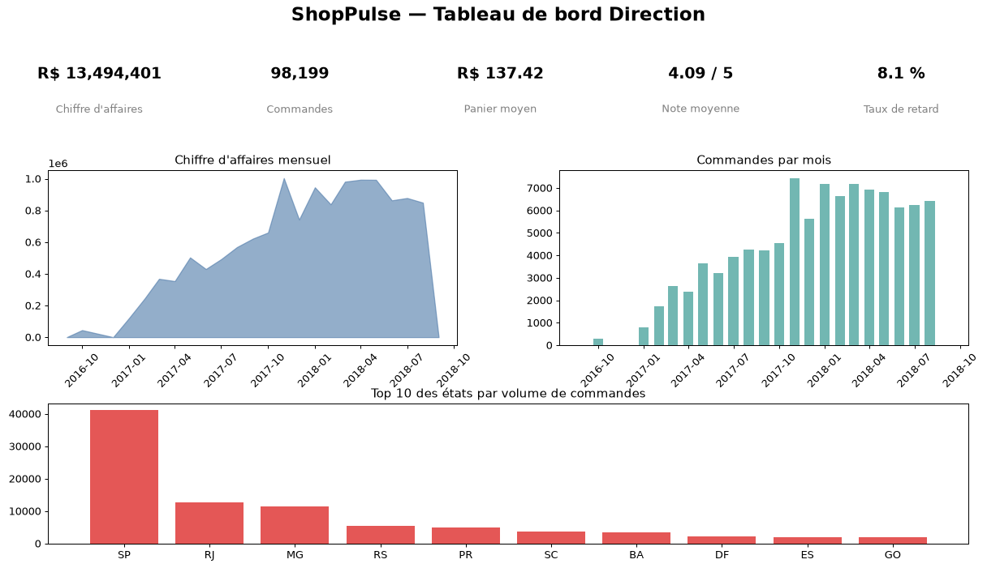

# ShopPulse — Plateforme Data & IA

[](https://github.com/RFERT/ShopPulse_Data_Consulting/actions/workflows/ci.yml)

> Mission Flash — consultant data pour **ShopPulse**, marketplace e-commerce fictive.
> Jeu de données : **Brazilian E-Commerce Public Dataset by Olist** (Kaggle).

Plateforme data & IA réduite mais complète : base consolidée PostgreSQL, pipeline ETL
rejouable (Airflow), analyses marketing (RFM + clustering), modèles de prédiction
(retard de livraison, sentiment des avis) servis par une **API FastAPI conteneurisée**,
le tout avec tests et CI.

## 🎯 Les 4 questions métier

| Question | Destinataire | Réponse livrée |
|---|---|---|
| Qui sont nos clients et comment les cibler ? | Marketing | Segmentation RFM + clustering, 3 personas, 3 actions chiffrées |
| Quelle commande risque d'arriver en retard ? | Logistique | Modèle de classification servi par l'API |
| Que disent les clients dans leurs avis ? | Service client | Sentiment : baseline TF-IDF vs réseau de neurones |
| Comment se porte l'activité ? | Direction | Tableau de bord Streamlit à 5 indicateurs |

## 🏗️ Architecture

Voir [docs/architecture.md](docs/architecture.md).

Stack : **PostgreSQL** · **Airflow** (ETL) · **scikit-learn / PyTorch** · **FastAPI** ·
**Streamlit** · **Docker** · **GitHub Actions**.

## 📊 Aperçu du tableau de bord



## 📂 Arborescence

```
shoppulse/
├── README.md            # pitch, architecture, installation, démo
├── docs/                # cadrage, arbitrage, architecture, éthique, rétro
├── data/samples/        # échantillons < 1 Mo (jamais les données complètes)
├── sql/                 # schéma et requêtes d'analyse
├── pipelines/           # flux ETL (DAGs Airflow + package ETL)
├── notebooks/           # EDA, statistiques, segmentation, expérimentations
├── src/shoppulse/       # package Python : features, modèles, API
├── tests/               # tests unitaires et tests de données
├── dashboards/          # tableau de bord Streamlit
├── infra/               # Dockerfile, docker-compose
└── .github/workflows/   # CI
```

## 🚀 Installation & lancement

### Prérequis
- Docker / Docker Desktop
- Python 3.11+ (pour le développement hors conteneurs)

### Démarrage complet (recommandé)
```bash
cp .env.example .env
docker compose -f infra/docker-compose.yml up -d
```

Services exposés :
- **API** : http://localhost:8000 — documentation OpenAPI sur http://localhost:8000/docs
- **Dashboard** : http://localhost:8501
- **Airflow** : http://localhost:8080 (admin / admin)
- **PostgreSQL** : localhost:5432

### Développement local
```bash
python -m venv .venv
. .venv/Scripts/activate        # Windows :  .venv\Scripts\Activate.ps1
pip install -e ".[dev]"
ruff check .
pytest
```

> L'entraînement du réseau de neurones de sentiment nécessite PyTorch :
> `pip install -e ".[train]"` (l'API, elle, sert des modèles scikit-learn et n'en a pas besoin).

## 📊 Données

Les données complètes Olist **ne sont jamais versionnées**. Seuls des échantillons
< 1 Mo figurent dans [data/samples/](data/samples/). La procédure de récupération du
jeu complet (Kaggle) est décrite dans [docs/cadrage.md](docs/cadrage.md).

## 🔌 Utilisation de l'API

Documentation interactive : http://localhost:8000/docs

```bash
# Sentiment d'un avis (portugais)
curl -X POST localhost:8000/predict/sentiment \
     -H "Content-Type: application/json" \
     -d '{"texte":"produto excelente, entrega rápida"}'
# -> {"sentiment":"positif","probabilite_positif":0.97}

# Risque de retard d'une commande
curl -X POST localhost:8000/predict/retard \
     -H "Content-Type: application/json" \
     -d '{"distance_km":450,"delai_estime_jours":15,"poids_total":1800,"volume_moy":12000,
          "fret_total":25,"prix_total":180,"n_items":1,"seller_order_count":120,
          "customer_state":"RJ","seller_state":"SP"}'
# -> {"probabilite_retard":0.73,"risque_eleve":true,"seuil":0.3}
```

## 🔁 Rejouer le pipeline et l'entraînement

```bash
# 1. Charger les données dans PostgreSQL (échantillons ou jeu complet)
python -m shoppulse_etl.flow --source data/olist

# 2. (Ré)entraîner les modèles et régénérer les rapports
pip install -e ".[train]"      # PyTorch pour le réseau de neurones
python -m shoppulse.models.train
```

## 📚 Documentation

| Document | Contenu |
|---|---|
| [docs/cadrage.md](docs/cadrage.md) | Note de cadrage (enjeux, objectifs, utilisateurs) |
| [docs/arbitrage.md](docs/arbitrage.md) | Arbitrages techniques |
| [docs/architecture.md](docs/architecture.md) | Schéma d'architecture cible |
| [docs/mld.md](docs/mld.md) | Modèle de données |
| [docs/marketing.md](docs/marketing.md) | Personas & recommandations chiffrées |
| [docs/rapport_qualite.md](docs/rapport_qualite.md) | Rapport qualité ETL |
| [docs/rapport_modeles.md](docs/rapport_modeles.md) | Performances des modèles |
| [docs/ethique.md](docs/ethique.md) | Note éthique (biais, RGPD, limites) |
| [docs/retro.md](docs/retro.md) | Rétrospective |
| [docs/video_script.md](docs/video_script.md) | Support & script de la soutenance |

## 🧪 Qualité & CI

- Lint & format : **ruff**
- Tests : **pytest** (couverture ≥ 50 %)
- CI : **GitHub Actions** (lint → tests → build d'image) — voir [.github/workflows/ci.yml](.github/workflows/ci.yml)

## 🤖 Usage de l'IA

Ce projet a été réalisé avec l'assistance d'un agent IA (Copilot). Les décisions
d'architecture, les arbitrages d'outils et la validation des livrables restent sous
la responsabilité de l'auteur. Détail dans [docs/retro.md](docs/retro.md).

## 👤 Auteur

RFERT — HETIC, 2ᵉ année.
