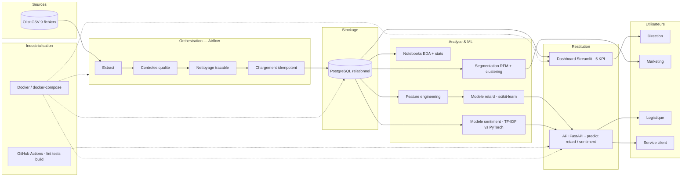

# Architecture cible — ShopPulse

Plateforme data & IA conteneurisée, du fichier source à la décision métier.

## Schéma d'architecture

## Composants

| Couche | Technologie | Rôle |
|---|---|---|
| **Ingestion / ETL** | Airflow + package `shoppulse_etl` | Extraction, qualité, nettoyage, chargement **idempotent** et **rejouable** |
| **Stockage** | PostgreSQL | Base relationnelle consolidée (9 tables, clés et index) |
| **Analyse** | pandas, scikit-learn, notebooks | EDA, tests statistiques, RFM, clustering |
| **Modèles** | scikit-learn (retard), PyTorch (sentiment) | Prédiction de retard et analyse de sentiment |
| **API** | FastAPI + Pydantic | Un endpoint par modèle, validation des entrées, OpenAPI |
| **Dashboard** | Streamlit | 5 indicateurs clés pour la Direction |
| **Industrialisation** | Docker, docker-compose, GitHub Actions, ruff, pytest | Reproductibilité, qualité, intégration continue |

## Flux de données

1. Les **9 CSV Olist** sont extraits par le pipeline.
2. Les **contrôles qualité** profilent chaque table (lignes, nulls, doublons).
3. Le **nettoyage** (déduplication, typage, intégrité référentielle) est **tracé** dans
   un rapport avant/après.
4. Les données sont **chargées de façon idempotente** dans PostgreSQL.
5. Les **notebooks** et scripts produisent analyses, segments et **features**.
6. Les **modèles** sont entraînés puis sérialisés dans `artifacts/`.
7. L'**API** sert les prédictions ; le **dashboard** expose les KPI.
8. **Docker** conteneurise l'ensemble ; **GitHub Actions** valide chaque changement.

## Principes

- **Réversibilité** : le pipeline est découplé d'Airflow (exécutable en CLI).
- **Reproductibilité** : tout est conteneurisé ; un tiers clone et lance en < 30 min.
- **Idempotence** : rejouer le pipeline produit exactement le même état.
- **Sécurité** : aucun secret versionné ; configuration par variables d'environnement.
