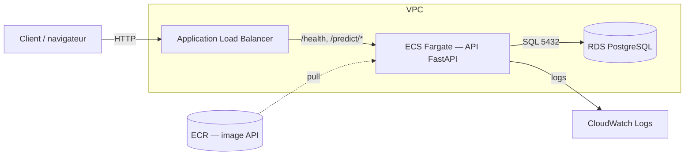

# Déploiement cloud & estimation de coût (bonus)

Déploiement de l'API ShopPulse sur **AWS ECS Fargate + RDS PostgreSQL**. L'IaC
Terraform est fournie dans [`infra/aws/`](../infra/aws/). **Non déployé** dans le
cadre de la mission (aucun credential) : ce document sert de **preuve d'ingénierie
reproductible et chiffrée**.

## Architecture cible

- **Image** poussée sur **ECR**, exécutée en **Fargate** (serverless, pas de serveur à gérer).
- **ALB** expose l'API publiquement (health-check `/health`).
- **RDS PostgreSQL** héberge la base consolidée.
- **CloudWatch** centralise les logs (complémentaire du bonus ELK en local).

## Estimation du coût mensuel

Hypothèses : région **eu-west-3 (Paris)**, **1 tâche** Fargate 0,25 vCPU / 0,5 Go en
continu (730 h), RDS `db.t4g.micro` **single-AZ** + 20 Go gp3, trafic faible. Tarifs
indicatifs à la publication (USD, hors taxes).

| Poste | Détail | Coût mensuel (~USD) |
|-------|--------|---------------------|
| ECS Fargate | 0,25 vCPU + 0,5 Go × 730 h | ~10 |
| RDS PostgreSQL | `db.t4g.micro` single-AZ + 20 Go gp3 | ~16 |
| Application Load Balancer | ~730 h + LCU faible | ~20 |
| ECR | stockage image (~1,5 Go) | ~0,2 |
| CloudWatch Logs | faible volume | ~1 |
| Transfert sortant | faible | ~2 |
| **Total** | | **~50 / mois** |

> Ces montants sont des **ordres de grandeur** ; le coût réel dépend du trafic, de la
> région et des remises. À valider avec l'[AWS Pricing Calculator](https://calculator.aws/).

## Leviers d'optimisation

- **Fargate Spot** : jusqu'à ~70 % d'économie sur la compute (charges tolérantes à l'interruption).
- **Supprimer l'ALB** pour un POC : *Lambda + API Gateway* ou *ECS Service Connect*, voire
  une **Function URL**, évitent le coût fixe de l'ALB (~20 USD/mois).
- **Aurora Serverless v2** (capacité minimale) ou arrêt planifié de RDS hors heures ouvrées.
- **Auto-scaling** du service sur l'utilisation CPU pour ne payer que la charge réelle.
- **Cycle de vie ECR** pour purger les anciennes images.

## Limites

- Déploiement **non exécuté** (pas de compte AWS fourni) ; l'IaC est validée
  syntaxiquement mais non `apply`-ée.
- En production : activer **HTTPS** (ACM + listener 443), passer RDS en **multi-AZ**,
  stocker les secrets dans **Secrets Manager**, et utiliser un **backend S3 chiffré**
  pour l'état Terraform.
