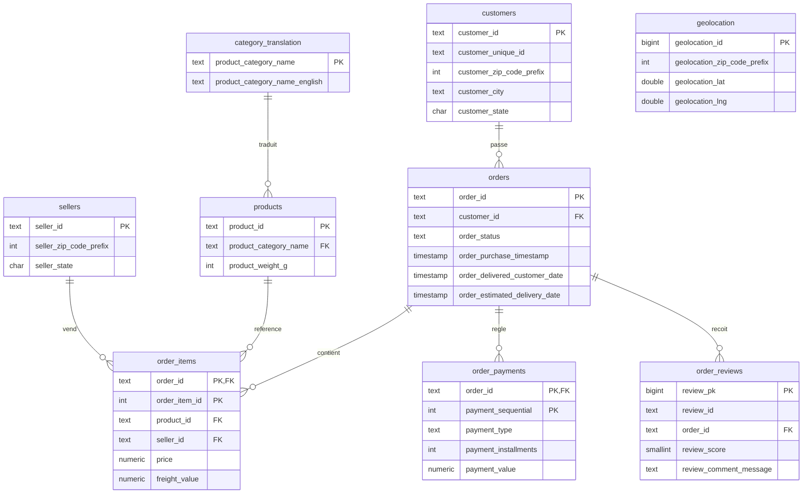

# Modèle Logique de Données (MLD) — ShopPulse / Olist

Le modèle consolide les **9 fichiers CSV Olist** en une base relationnelle PostgreSQL
normalisée. Il distingue les **tables de référence** (catalogue, géographie, acteurs)
des **tables transactionnelles** (commandes et leurs satellites).

## Diagramme entité-association

## Choix de modélisation

| Décision | Justification |
|---|---|
| **Clé de substitution** sur `geolocation` et `order_reviews` | Pas de clé naturelle : un préfixe de code postal a plusieurs coordonnées ; un `review_id` peut apparaître sur plusieurs commandes. |
| **Clés composites** `order_items(order_id, order_item_id)` et `order_payments(order_id, payment_sequential)` | Reflètent la granularité réelle (ligne d'article, séquence de paiement). |
| **FK `products.product_category_name` nullable** | Certaines catégories sont absentes de la table de traduction : mises à NULL par le pipeline plutôt que de rejeter la ligne. |
| **`review_score` contraint à [1,5]** | Garantit la cohérence métier dès la base. |
| **Index** sur FK et colonnes de filtre (`order_status`, `order_purchase_timestamp`, `review_score`) | Accélère les requêtes analytiques et le dashboard. |
| **`geolocation` non reliée par FK** | Table de référence géographique rattachée par préfixe de code postal applicatif (jointure analytique, pas contrainte). |

## Correctifs appliqués par le pipeline

- Renommage des colonnes mal orthographiées dans la source Olist :
  `product_name_lenght → product_name_length`, `product_description_lenght → product_description_length`.
- Déduplication sur les clés, nettoyage des espaces, filtrage des orphelins (intégrité référentielle).

Le schéma SQL exécutable est dans [../sql/schema.sql](../sql/schema.sql).
